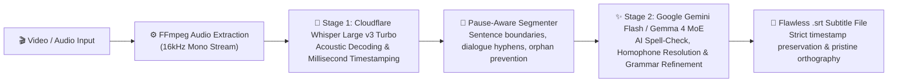

# Online Subtitle Generator


<p align="center">
  <strong>Next-Generation Multilingual Subtitle Studio powered by Cloudflare Workers AI Whisper, Google Gemini Flash & Gemma 4 26B</strong>
</p>

<p align="center">
  
  
  
  
  
  
</p>

---

## Overview

**Online Subtitle Generator** is a high-performance Windows desktop application designed to generate broadcast-quality, grammatically perfect subtitles (`.srt`) directly from local video and audio files. 

Unlike conventional speech recognition tools that produce raw, error-prone text with frequent spelling mistakes and awkward sentence splits, **Online Subtitle Generator** introduces a state-of-the-art **Two-Stage Dual-Engine AI Pipeline**:

1. **Acoustic Speech Recognition:** **OpenAI Whisper Large v3 Turbo** (`@cf/openai/whisper-large-v3-turbo`) on Cloudflare Workers AI decodes audio frames with millisecond-accurate timestamping.
2. **Intelligent Linguistic Refinement:** **Google Gemini Flash Multi-Model Rotation Pool** (`gemini-3.5-flash-lite`, `gemini-3-flash`, `gemini-3.8-flash`) and **Google Gemma 4 26B MoE** review the transcribed cues, correcting homophones, spelling typos, grammatical slips, and language-specific orthography (such as Persian *half-spaces / نیم‌فاصله*) while **mathematically preserving** every single cue's start and end timestamps.

Supported by a **Multi-Account Failover Pool** of up to 10 Cloudflare accounts and up to 10 Google Gemini accounts, the application effortlessly handles overnight batch workflows at enterprise speed with **zero monthly subscription costs**.


<table align="center">
  <tr>
    <td align="center">
      <a href="https://github.com/user-attachments/assets/e3a02370-701f-4d8b-b3cf-ffea3330f1c9" target="_blank">
        
      </a>
    </td>
    <td align="center">
      <a href="https://github.com/user-attachments/assets/5338e424-61e4-48cf-add1-6cdec316106b" target="_blank">
        
      </a>
    </td>
  </tr>
</table>


---

## Architecture: The Two-Stage AI Pipeline



---

## Key Features

### 🎙️ 1. Dual-Engine AI Subtitle Architecture
* **Whisper Large v3 Turbo (`@cf/openai/whisper-large-v3-turbo`):**
  * The fastest, most accurate flagship speech recognition model from OpenAI, deployed on Cloudflare's serverless edge infrastructure.
  * Native Voice Activity Detection (VAD) and automated silence truncation eliminate audio hallucination loops.
* **Google Gemini Flash & Gemma 4 AI Refinement:**
  * **Google Gemini Flash Multi-Model Pool (Recommended):** High-speed, ultra-accurate proofreading powered by Google's native Gemini models (`gemini-3.5-flash-lite`, `gemini-3-flash-preview`, `gemini-3.8-flash`). Automatically handles spikes in traffic and rate limits by rotating across models.
  * **Intelligent Homophone Disambiguation:** Distinguishes sound-alike words using sentence semantics (e.g. Persian `گذار/گزار`, `حیات/حیاط`, `ص/س/ث`, `ز/ض/ظ/ذ`, `تصویر/تصفیر`, `هاله/خاله`, or English `their/there/they're`, `its/it's`).
  * **Orthography & Half-Spaces:** Automatically applies correct typography (e.g., Persian *nim-faseleh* `می‌شود` and compound nouns) without robotic formalization.
  * **Zero-Drift Guarantee:** The LLM refines strictly line-by-line using index anchors. Timestamps, cue counts, and sync remain 100% untouched.

---

### 🌐 2. Rich Multilingual Support with Direct Language Priming
Whisper is no longer forced to guess the spoken language. Users can directly select the target language from the interface, optimizing the acoustic decoder and applying custom linguistic rules:

| Supported Language | Language Code | Specialized AI Refinement Capabilities |
| :--- | :---: | :--- |
| **English** | `en` | Homophones, capitalization, punctuation, apostrophes |
| **Persian (Farsi)** | `fa` | Homophones (`ز/ض/ظ/ذ`, `س/ص/ث`), نیم‌فاصله, conversational grammar |
| **Arabic** | `ar` | Hamza (`أ/إ/آ/ا`), Taa Marbuta (`ة/ه`), Arabic punctuation (`،`, `؟`) |
| **Turkish** | `tr` | Dotless I (`ı/i`), special vowels (`ö/ü/ğ/ş`), suffixes |
| **French** | `fr` | Accents (`é/è/ê/ë`), elisions, apostrophe spacing |
| **German** | `de` | Umlauts (`ä/ö/ü/ß`), noun capitalization, compound words |
| **Spanish** | `es` | Inverted punctuation (`¿?`, `¡!`), acute accents |
| **Italian** | `it` | Accent markers, contractions, dialogue punctuation |
| **Russian** | `ru` | Case endings, hard/soft signs (`ъ/ь`), punctuation |
| **Chinese** | `zh` | Simplified/Traditional character consistency, sentence pauses |
| **Japanese** | `ja` | Kanji/Hiragana/Katakana balance, natural sentence segmentation |
| **Korean** | `ko` | Hangul spacing, particle alignment, honorifics |
| **Hindi** | `hi` | Matras, conjunct consonants, Devanagari punctuation |
| **Portuguese** | `pt` | Tildes (`ã/õ`), cedillas (`ç`), European & Brazilian spelling |
| **Auto-Detect** | `auto` | Automatic language identification across 99+ languages |

---

### ⚡ 3. Multi-Account Failover Pool (Up to 10 Accounts)
* **100,000 Free Daily Neurons:** Cloudflare Workers AI offers 10,000 free neurons daily per account. By registering up to 10 accounts in the built-in credential manager, you gain **100,000 free daily neurons** — sufficient for transcribing and refining over **1,200,000 words** (60–80 full feature films) every single day for free!
* **Automated Sticky Hot-Swapping:** When Account #1 reaches its rate limit or neuron ceiling, the engine instantly rotates to Account #2, #3, and beyond without crashing or halting your queue.
* **Persistent Cooldown Tracking:** Rate-limited accounts enter a smart cooldown until daily reset, ensuring zero wasted retries.

---

### 🎬 4. Broadcast-Standard Subtitle Segmentation
* **Grammar-Aware Boundaries:** Prevents awkward line wraps after articles (`the`, `a`), prepositions (`in`, `on`, `with`), or conjunctions.
* **Orphan Word Elimination:** Prevents lonely 1-word cues (e.g. `Sure.`, `Tomorrow?`) by merging them naturally with their parent dialogue.
* **Speaker Turn Hyphens:** Fast conversational exchanges are formatted with dual-speaker dashes:
  ```srt
  12
  00:01:14,200 --> 00:01:17,500
  - Are you coming tonight?
  - Yes, see you at eight.
  ```
* **Silence Gap Detection:** Natural pauses $\ge 0.40$s accurately separate distinct phrases.

---

### 📁 5. Batch Processing Manager with Real-Time File Telemetry
* **Folder & File Queuing:** Batch-import entire seasons or collections of videos (`.mp4`, `.mkv`, `.avi`, `.mov`, `.webm`, `.flv`, `.ts`).
* **Per-Video Configuration:** Customize start/end minutes, target language, and AI refinement toggle per file, or apply settings to the entire batch in one click.
* **Real-Time Live Logs:** Non-cumulative, per-file terminal box displays live chunk extraction, Cloudflare latency, and token throughput.
* **Failure Isolation:** If an individual video has corrupt audio, it is marked as `FAILED` while remaining queue items continue smoothly.

---

### 🔒 6. Security, Zero-Dependency Setup & Portability
* **100% Portable:** Pre-packaged with static **FFmpeg** and **FFprobe** binaries. No external system installations required.
* **Hardware-Safe Execution:** Windows DPAPI encryption stores Cloudflare API credentials securely in the Windows Credential Manager — zero plaintext keys on disk.
* **Accessible Dark Theme:** Modern Windows 11 Fluent dark palette with high-contrast text and responsive controls.

---

## Quick Start & Installation

### Option 1: Pre-Built Portable Executable (Recommended)
1. Download the latest release from the [Releases](https://github.com/AliDevCore/Online-Subtitle-Generator/releases) page.
2. Extract `Online-Subtitle-Generator-v*.zip` into any folder.
3. Launch `Online Subtitle Generator.exe`.

### Option 2: Run from Source
```bash
# 1. Clone the repository
git clone https://github.com/AliDevCore/Online-Subtitle-Generator.git
cd "Online Subtitle Generator"

# 2. Install dependencies
pip install -r requirements-dev.txt

# 3. Run the automated test suite (67 tests)
pytest

# 4. Launch the desktop studio
python app/main.py
```

---

## Configuring Cloudflare Credentials

1. Click **🔑 Cloudflare Accounts (Pool)** on the top-right toolbar.
2. Obtain your free **Account ID** and **API Token** (with *Workers AI Read/Write* permissions) from your [Cloudflare Dashboard](https://dash.cloudflare.com/).
3. Enter your credentials into Slot 1 (and optionally Slots 2 through 10 for multi-account pooling).
4. Click **Save Account**. You are ready to generate subtitles!

---

## Automated CI/CD & Compilation

The project features a continuous delivery pipeline powered by **GitHub Actions**:
* Every commit pushed to the `main` branch automatically triggers headless offscreen testing, semver tag incrementation, PyInstaller bundling, SHA-256 checksum generation, and publishes a new release on GitHub.
* For more information on release management, see [RELEASE_GUIDE.md](docs/RELEASE_GUIDE.md).

---

## License

This project is licensed under the **MIT License**. See the [LICENSE](LICENSE) file for complete terms.
