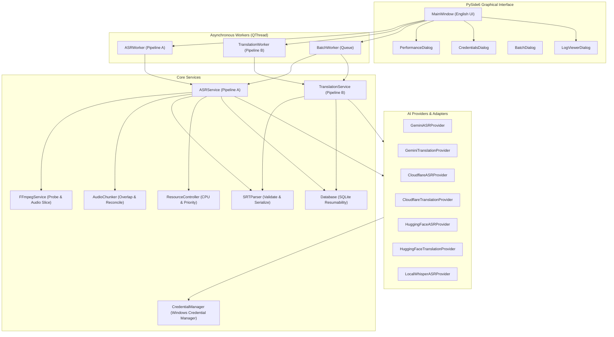

# OnlineSub Architecture

## Architectural Design Principles

1. **Independent Pipelines**: ASR and Translation are completely decoupled. Translation operates directly on `.srt` files and never requires media files or rerunning speech recognition.
2. **Local vs Cloud Resource Separation**: CPU Usage Target and Process Priority are applied strictly to local FFmpeg extraction and local Faster-Whisper inference. Cloud API network requests are never throttled.
3. **Zero Plaintext Credentials**: API keys are routed through Windows Credential Manager and redacted from all logs and diagnostics.
4. **Resumability**: Multi-chunk operations and batch queues persist their state in SQLite (`onlinesub.db`).
