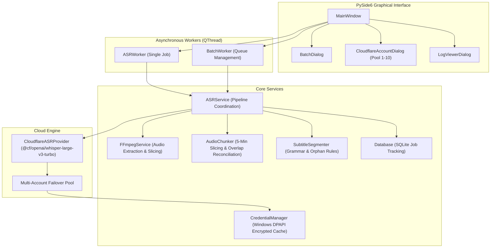

# Online Subtitle Generator - Architecture

## System Components

1. **User Interface (`app.ui`)**:
   - Modern PySide6 interface with responsive layouts, time range configuration, and real-time progress reporting.
   - Clean lifecycle management: background workers are safely stopped before window closing to avoid thread dangling.

2. **ASR Service & Audio Chunker (`app.services`, `app.core.audio_chunker`)**:
   - Slices audio streams into 5-minute chunks with 2-second overlap buffers.
   - Automatically merges boundary cues using phrase reconciliation to eliminate duplicate sentences across chunks.
   - Tail chunks shorter than 20 seconds are absorbed into the preceding chunk.

3. **Cloudflare ASR Provider (`app.providers.cloudflare_provider`)**:
   - Sends audio chunks to Cloudflare Workers AI Whisper endpoint.
   - Intelligent status code handling:
     - 401/403: Marks token invalid and aborts or skips if no valid tokens remain.
     - 429/Quota: Places account on cooldown and switches to next pool account.
     - 5xx/Timeout: Retries with exponential backoff up to 5 attempts.

4. **Subtitle Segmenter (`app.core.subtitle_segmenter`)**:
   - Parses raw Whisper cues.
   - Filters silence hallucination tokens and repetitive noise.
   - Applies natural punctuation, grammar-aware line splitting, and broadcast-standard dialogue turn formatting.
